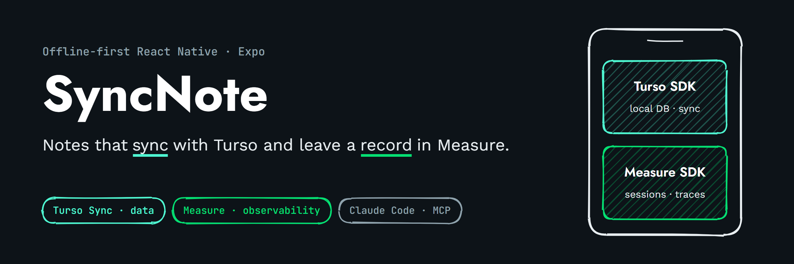
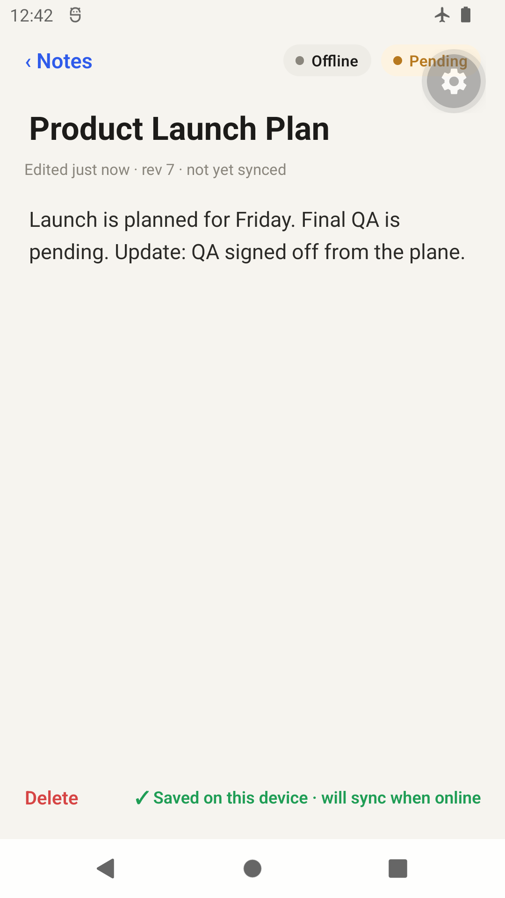
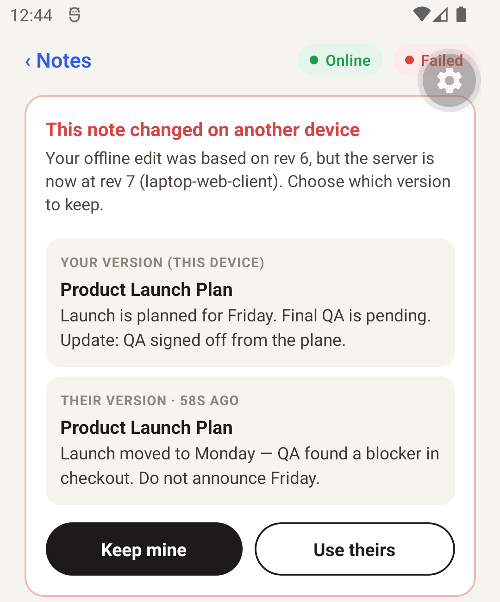
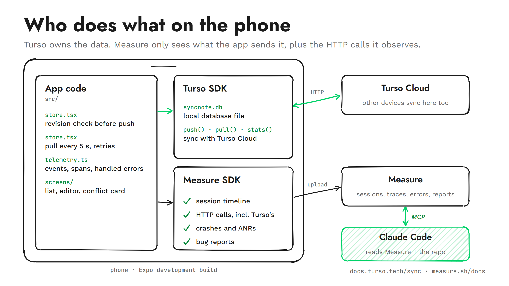
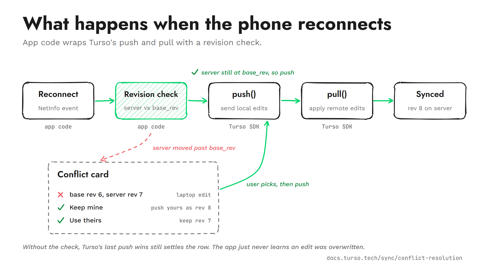
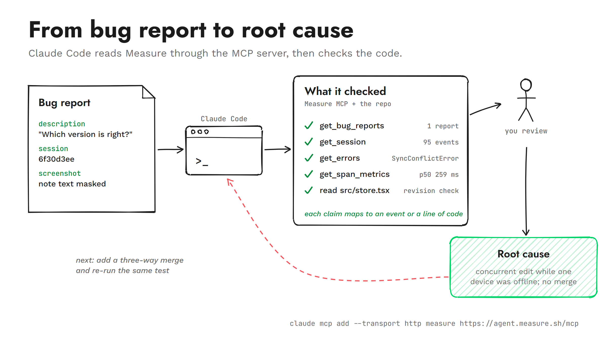

# SyncNote

An offline-first notes app built with React Native and Expo.

- **[Turso Sync](https://docs.turso.tech/sync)** keeps the notes in a local database on the phone and syncs them with Turso Cloud.
- **[Measure](https://measure.sh)** records what happens on the device, so you can see why a sync failed in production.
- **[Claude Code](https://claude.com/claude-code)** reads that data through the [Measure MCP server](https://measure.sh/docs/mcp) and helps find the root cause.

| Saved offline | Edit from another device | Conflict on reconnect |
|---|---|---|
|  |  |  |

## Features

- Create, edit and delete notes. Every save goes to the local database first, so it works offline.
- Online/offline indicator and sync status: **Synced**, **Pending**, **Syncing** or **Failed**.
- Syncs on save, on reconnect and on launch. Pulls every 5 seconds while the app is open.
- Retries failed syncs automatically.
- Detects when two devices edited the same note and lets the user pick **Keep mine** or **Use theirs**.
- In-app bug reports through Measure (from the menu, or by shaking the phone).

## Turso and Measure

They do separate jobs and don't talk to each other. The app connects them.

| | Turso | Measure |
|---|---|---|
| **Job** | Data: local storage and sync | Observability: what happened on the device |
| **In this app** | `syncnote.db` on the phone, `push()` and `pull()` to Turso Cloud | Events, traces, handled errors, HTTP calls, crashes, ANRs and bug reports |
| **Code** | [src/db.ts](src/db.ts) | [src/telemetry.ts](src/telemetry.ts) |



### Conflicts

Turso Sync resolves conflicts with [last push wins](https://docs.turso.tech/sync/conflict-resolution). To tell the user when two people edited the same note, the app adds a revision check before each push. Every note has a `rev`. If the server moved past the revision an offline edit started from, the push is held and the user picks a version. See [src/store.tsx](src/store.tsx).



### What goes to Measure

- **Events** for each sync step, such as `note_saved_locally`, `sync_started`, `sync_conflict_detected` and `sync_completed`.
- **Traces:** each sync is a `sync` span with `sync.revision_check`, `sync.push` and `sync.pull` children. These are app-side spans around the Turso SDK calls.
- **Handled errors** with the sync phase and connection type.
- **HTTP calls** and **bug reports** with masked screenshots.

Note text never leaves the device. Only ids, revision numbers, counts and timings are sent.

## Getting started

You need Node 20+, the Android SDK with an emulator or device, and JDK 17.

```sh
# 1. Create a Turso database and a token
turso db create syncnote
turso db show syncnote --url
turso db tokens create syncnote --expiration 7d

# 2. Create a Measure app (package: sh.demo.syncnote) at measure.sh

# 3. Configure and install
cp .env.example .env              # fill in the Turso URL/token and Measure key/URL
npm install
npm run remote:setup              # creates the notes table and a demo note

# 4. Build and run (a development build; Expo Go can't load the native SDKs)
npx expo prebuild --platform android --clean
npx expo run:android
```

After the first build, `npm start` is enough. The first launch needs a connection to download the database.

> This demo bundles the Turso token into the app. In production, issue short-lived tokens from your backend.

On Windows, keep the project in a short path such as `E:\turso_measure_demo`. The native build can exceed the 260-character path limit.

## Scripts

| Command | What it does |
|---|---|
| `npm start` | Start Metro for the development build |
| `npm run android` | Build and run on Android |
| `npm run typecheck` | Run TypeScript checks |
| `npm run remote:setup` | Create the `notes` table in Turso Cloud |
| `npm run remote:edit` | Edit the demo note from "another device" |
| `npm run remote:show` | Print the server's copy of the demo note |
| `npm run remote:reset` | Restore the demo note |

The `remote:*` scripts ([scripts/other-device.mjs](scripts/other-device.mjs)) talk to Turso Cloud directly, standing in for a second device.

## Debugging with Claude Code

```sh
claude mcp add --transport http measure https://agent.measure.sh/mcp
```

Then ask Claude Code, from this repo, to find a sync failure in Measure and explain it. It reads the bug report, session timeline and errors through the MCP server, then checks them against the code.



## Project structure

```
src/
  App.tsx         app shell
  store.tsx       sync engine: push/pull, live pull, retries, revision check
  db.ts           local databases (Turso)
  remote.ts       read-only server query for the revision check
  telemetry.ts    all Measure calls
  screens/        notes list and editor
  components/     status pills, menu sheet
scripts/          the "other device" script
plugins/          Expo config plugin that fixes the Turso Android build
docs/images/      images used in this README
```

Only Android has been tested.

## License

MIT. See [LICENSE](LICENSE).
