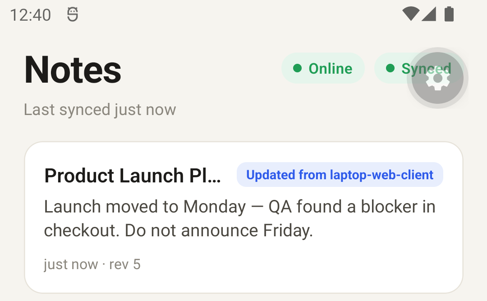
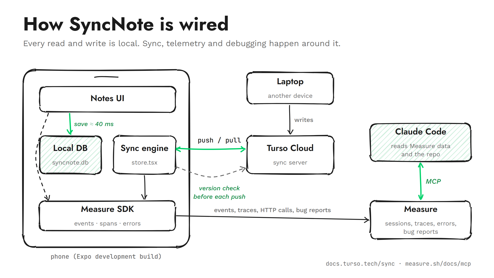

# SyncNote

An offline-first notes app in React Native and Expo, built to try three tools on one real problem: an app whose data has to survive a plane, a basement and a second device editing the same note.

**Turso Sync** stores the notes on the phone and syncs them. **Measure** records what happened on the device when sync misbehaves. **Claude Code**, through the [Measure MCP server](https://measure.sh/docs/mcp), reads that record and explains why.

📖 Full write-up with real numbers: [docs/BLOG.md](docs/BLOG.md) · 🎬 Demo script: [DEMO.md](DEMO.md)

| Saved offline | Edit from another device | Conflict on reconnect |
|---|---|---|
|  |  |  |

## What the app does

- A notes list and an editor: create, edit and delete notes.
- Every save writes to a local database first, so saving works the same on Wi-Fi, on 2G and in airplane mode.
- An **Online / Offline** pill and a sync pill: **Synced**, **Pending**, **Syncing…** or **Failed**.
- Syncs on save, on reconnect and on app open. While open, it also pulls every 5 seconds, so another device's edit lands within a few seconds.
- Failed syncs retry on their own, at most every 15 seconds.
- If two people edited the same note, a card shows both versions with **Keep mine** and **Use theirs**.
- **••• More** opens **Report a problem** (Measure's bug report screen, also on shake) and **Reset demo note**.

## Who does what

| The problem | Turso handles | Measure shows |
|---|---|---|
| Saving with no signal | Reads and writes go to a local database file; changes wait there until `push()` | `note_saved_locally` with `local_write_ms`, and the app reopening offline with pending edits |
| Another device's edit | `pull()` brings down only what changed | `remote_changes_received`, plus `turso.pull` traces (p50/p95) |
| A slow or failing network | The UI never waits on the network | `SlowSyncError` per sync phase, network errors tagged with `connection_type`, and Turso's HTTP calls on the timeline |
| Two people, one note | Sync is last-push-wins, so the app adds a revision check | `sync_conflict_detected`, `SyncConflictError`, the user's bug report, and `conflict_resolved` — all in one session |

Everything in the Turso column comes from the SDK. The revision check and the conflict screen are app code, in [src/store.tsx](src/store.tsx).

## How it works



Two database files sit on the phone:

- **`syncnote.db`** — the Turso database that syncs with Turso Cloud.
- **`syncnote-meta.db`** — local only. The queue of unsynced edits and the device id. It never leaves the phone.

### Conflicts

Turso's [rules](https://docs.turso.tech/sync/conflict-resolution) are short. On pull, your unpushed changes are rolled back, remote changes are applied, and yours are replayed on top. On push, if two devices changed the same row, **the last push wins**.

That's fine until two people edit one note while one of them is offline — then an edit silently disappears. So before pushing, the app checks: every note carries a `rev`, the first offline edit remembers the `base_rev` it started from, and a read-only query asks Turso Cloud what revision the server has. If the server moved past `base_rev`, the push is held and the user picks a version.


## Quick start

**You need:** Node 20+, the Android SDK with an emulator or device, and JDK 17 (`JAVA_HOME`). On Windows, keep the project in a short path like `E:\turso_measure_demo` — the native build goes over the 260-character limit in deep folders.

```sh
# 1. A Turso database
turso db create syncnote
turso db show syncnote --url      # libsql://syncnote-<org>.<region>.turso.io
turso db tokens create syncnote

# 2. A Measure app at measure.sh, package name sh.demo.syncnote, then copy its API key and URL

# 3. Configure
cp .env.example .env              # fill in the four values
npm install
npm run remote:setup              # creates the notes table and adds the demo note

# 4. Build and run (Expo Go can't load these native modules)
npx expo prebuild --platform android --clean
npx expo run:android
```

After the first build, `npm start` is enough. Run `prebuild` again only after changing the `MEASURE_*` values or the plugins.

The first launch needs a connection to download the database; after that the app works fully offline. With no Turso config at all, it runs in **Local only** mode: notes are saved on the phone and nothing syncs.

> The Turso token is bundled into the app because this is a demo. In production, hand out short-lived tokens from a backend — the SDK's `authToken` also takes an async function.

## Scripts

| Command | What it does |
|---|---|
| `npm start` | Metro, for the installed development build |
| `npm run android` | Build and run on Android |
| `npm run typecheck` | `tsc --noEmit` |
| `npm run remote:setup` | Create the `notes` table in Turso Cloud and add the demo note |
| `npm run remote:edit` | Act as "another device" and edit the demo note on the server |
| `npm run remote:show` | Print the server's copy of the demo note |
| `npm run remote:reset` | Restore the demo note on the server |

The `remote:*` scripts are [scripts/other-device.mjs](scripts/other-device.mjs), talking to Turso Cloud over `@libsql/client`. [DEMO.md](DEMO.md) uses them for the four scenarios: saving on a flight, an edit from a laptop, a throttled network, and two people editing one note.

## What Measure records

Every Measure call lives in [src/telemetry.ts](src/telemetry.ts), using only the public SDK (`trackEvent`, `trackError`, `startSpan`, `launchBugReport`, `onShake` and friends).

- **Events** for each step: `app_opened`, `note_created`, `note_edited`, `note_saved_locally`, `connectivity_changed`, `sync_started`, `remote_changes_received`, `sync_conflict_detected`, `sync_failed`, `conflict_resolved`, `sync_completed`, `note_deleted`. `sync_started` carries Turso's own `stats()` — how many changes were waiting and how stale the local copy was.
- **Traces:** each sync is a `turso.sync` trace with child spans `turso.conflict_check`, `turso.push` and `turso.pull`.
- **Handled errors:** `SyncConflictError`, `SlowSyncError` (a phase past 8 seconds; the sync isn't cancelled), plus network and auth failures. Measure samples handled errors at 0% by default — raise that in production.
- **Bug reports** with a screenshot (text masked by default), attached to the session they came from.
- **Automatically:** screen views, taps, launch time, and HTTP calls, including Turso's `/pull-updates` and `/v2/pipeline`. The `Authorization` header is never collected.

**Note text never leaves the device.** Only ids, revision numbers, lengths, counts and timings.

## Debugging with Claude Code

```sh
claude mcp add --transport http measure https://agent.measure.sh/mcp
```

Background the app for a few seconds so Measure uploads, then ask from inside the repo:

> A user filed a bug report about a sync conflict in SyncNote. Find it, analyze the session timeline, connectivity changes, sync attempts and conflict events, identify the root cause and suggest a fix.


It uses `get_bug_reports` to find the report, `get_session` for the timeline, `get_errors` for the error groups and `get_span_metrics_over_time` for sync timings, then reads `src/store.tsx` to tie it back to the code. [docs/BLOG.md](docs/BLOG.md) walks through a real run.

## Project layout

```
src/
  App.tsx       shell and navigation
  store.tsx     app state and the sync engine: push/pull, live pull, retries, conflict check
  db.ts         the two local databases
  remote.ts     read-only Turso Cloud query for the conflict check
  telemetry.ts  every Measure call
  screens/      NotesList, NoteEditor (with the conflict card)
  components/   status pills, the ••• More sheet
scripts/        the "other device": setup | edit | show | reset
plugins/        Expo config plugin that fixes the Turso Android build
docs/           the write-up, the dev.to version, screenshots and diagrams
```

## Known issues

- **Turso RN 0.8.3 compiles Rust on Android.** Its `build.gradle` runs `make android` even though prebuilt `.so` files ship in the package. [plugins/withTursoPrebuiltLibs.js](plugins/withTursoPrebuiltLibs.js) turns that task off, and it survives `prebuild --clean`.
- **`react-native-safe-area-context` isn't used** — its generated paths break the Windows path limit, so the app pads for the system bars itself.
- **`pull()` can return `true` right after your own push**, so the app compares rows to tell a real remote change from an echo.
- **`adb emu network speed` only throttles the emulated cellular link.** Turn Wi-Fi off in the emulator to test a slow network.
- **Only Android has been tested.** The iOS config is in place but hasn't been run.

## Links

[Turso Sync](https://docs.turso.tech/sync) · [Turso conflict resolution](https://docs.turso.tech/sync/conflict-resolution) · [Measure RN SDK](https://measure.sh/docs/getting-started/react-native) · [Measure MCP](https://measure.sh/docs/mcp) · [Measure on GitHub](https://github.com/measure-sh/measure) · [Expo dev builds](https://docs.expo.dev/develop/development-builds/introduction/) · [Claude Code](https://claude.com/claude-code)

MIT licensed — see [LICENSE](LICENSE).
