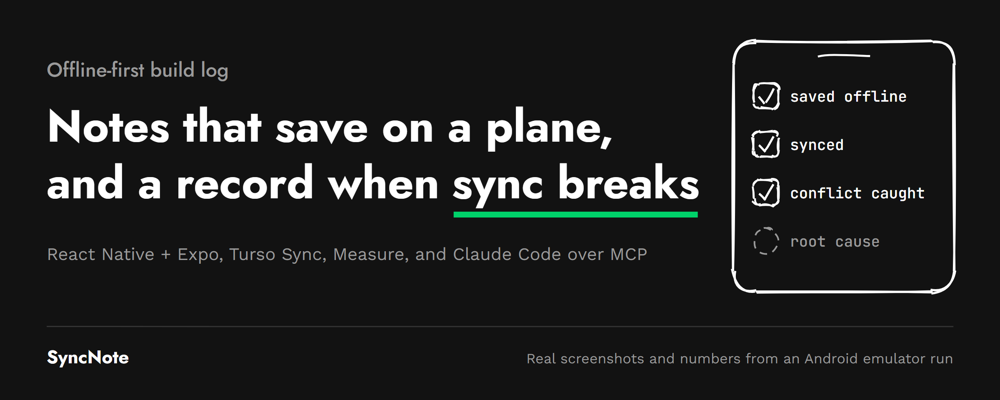

# Building an offline-first React Native app with Turso Sync, Measure and Claude Code (MCP)

## Tl;dr

- I built **SyncNote**, a small [React Native](https://reactnative.dev) and [Expo](https://docs.expo.dev) notes app meant to work without a signal.
- **[Turso Sync](https://docs.turso.tech/sync)** keeps the notes in a database file on the phone and syncs it with the cloud using `push()` and `pull()`.
- **[Measure](https://measure.sh)** records what happened on the device: events, traces, errors, network calls and bug reports.
- When a sync failed, **[Claude Code](https://claude.com/claude-code)** read that data through the **[Measure MCP server](https://measure.sh/docs/mcp)** and found the cause.
- Every number and screenshot below comes from a real run on an Android emulator, against a real Turso database and a real Measure project.

## Who it's for

Some people do most of their work where the signal is bad:

- a consultant typing up meeting notes on a flight
- a technician logging a site visit from a basement plant room
- someone updating a shared checklist on the metro

They don't care how sync works. They tap Save and expect the note to be there, and when the phone reconnects they expect it on their laptop too.

Building that turned up four problems. I'd guess most apps with shared data hit the same ones:

| What the user says | What the app needs |
|---|---|
| "I edited this on the plane. Did it save?" | Saves that never wait for the network and survive the app being killed |
| "I changed it on my laptop. Why isn't it on my phone?" | Sync that brings over changes from other devices quickly |
| "Sync is really slow for me." | A UI that stays fast on a bad network, plus a way to see what sync is doing out there |
| "My teammate's change is gone." | A rule for two people editing one note, and a record of what happened on a phone you don't have |

Turso handles the first two. The last two only show up once the app is on real phones, and that's where Measure and Claude Code came in.

## The stack

| Layer | Choice | Version |
|---|---|---|
| App | React Native + Expo (development build), TypeScript | Expo SDK 58, RN 0.88 |
| Local database and sync | [`@tursodatabase/sync-react-native`](https://www.npmjs.com/package/@tursodatabase/sync-react-native) | 0.8.3 |
| Mobile observability | [`@measuresh/react-native`](https://measure.sh/docs/getting-started/react-native), via its Expo config plugin | 0.5.1 |
| Connectivity | `@react-native-community/netinfo` | – |
| Debugging | Claude Code with the [Measure MCP server](https://measure.sh/docs/mcp) | – |

Both SDKs ship native code, so Expo Go won't run them. You need a [development build](https://docs.expo.dev/develop/development-builds/introduction/) (`npx expo run:android`).

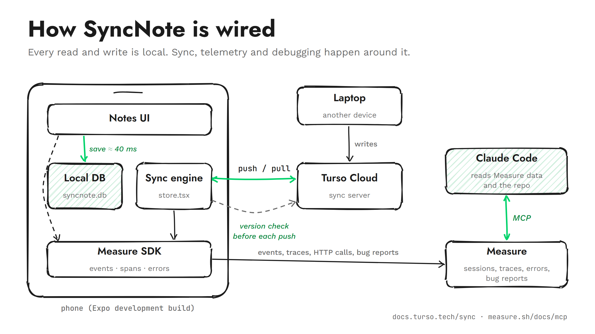

*The app only ever reads and writes the local file. Sync, telemetry and debugging all sit around it.*

## Store everything on the phone with Turso

The [Turso Sync docs](https://docs.turso.tech/sync) say reads and writes are local by default. For offline writes, they tell you to write locally and call `push()` when the connection comes back. I wanted exactly that, so the whole data layer is one database file on the phone.

```ts
// src/db.ts
import { Database, getDbPath } from '@tursodatabase/sync-react-native';

const notesDb = new Database({
  path: getDbPath('syncnote.db'),        // a real SQLite file on the device
  url: process.env.EXPO_PUBLIC_TURSO_URL, // libsql://<db>.turso.io
  authToken: process.env.EXPO_PUBLIC_TURSO_AUTH_TOKEN,
  clientName: `syncnote-${deviceId}`,
  bootstrapIfEmpty: true,                 // first launch downloads the DB once
});
await notesDb.connect();
```

Saving a note is a plain local write. It behaves the same on Wi-Fi, on 2G and in airplane mode, so there's no loading spinner and no offline mode to build.

```ts
await notesDb.run(
  'UPDATE notes SET title = ?, content = ?, rev = ?, updated_at = ?, updated_by = ? WHERE id = ?',
  [title, content, rev, Date.now(), deviceId, id],
);
```

Syncing takes two calls:

```ts
await notesDb.push();                   // send local changes to Turso Cloud
const changed = await notesDb.pull();   // apply other devices' changes locally
const stats = await notesDb.stats();    // pending changes, last pull time, bytes sent and received
```

The app syncs after every save while it's online, and again when the phone reconnects. While the app is open, it also pulls every 5 seconds. In my test, an edit made on the laptop appeared on the phone **about 4.4 seconds** later. The pull took **345 ms** and downloaded **about 4 KB**.

## Decide what happens when two people edit the same note

Turso's [conflict resolution page](https://docs.turso.tech/sync/conflict-resolution) explains the rules:

- **Pull:** Turso rolls the local database back to the last synced state, applies the remote changes, then replays your unpushed edits on top, all in one atomic step.
- **Push:** if two devices push changes to the same row, the last push wins.

For a notes app, that means if I edit a note offline while my teammate edits it online, whoever pushes last overwrites the other. Nobody gets an error. One person's work just disappears.

So I added a revision check in front of `push()`:

1. Every note has a `rev` number.
2. The first offline edit records the `base_rev` it started from.
3. Before pushing, the app asks Turso Cloud (read-only) what revision the server has.
4. If the server is past `base_rev`, someone else changed the note. The app holds the push and lets the user choose.

```ts
// src/store.tsx (simplified)
const remote = await fetchRemoteNotes(pendingUpdates.map((u) => u.note_id));
const conflicts = pendingUpdates.filter((u) => (remote.get(u.note_id)?.rev ?? 0) > u.base_rev);

if (conflicts.length) {
  track('sync_conflict_detected', { note_id, base_rev, remote_rev, remote_updated_by /* … */ });
  throw new SyncConflictError(conflicts);   // nothing is pushed; the UI asks the user
}
await notesDb.push();
await notesDb.pull();
```

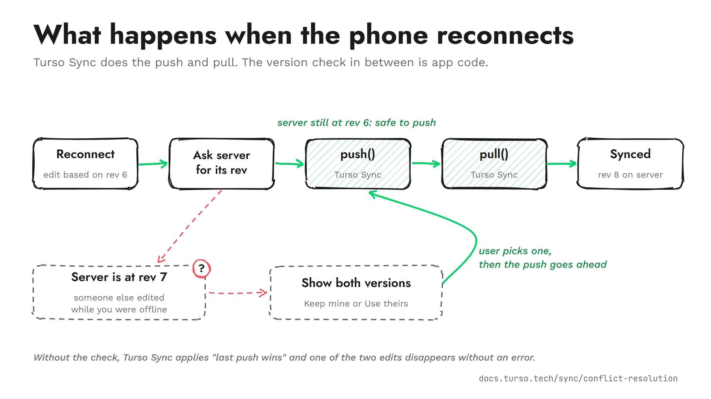

*Turso does the push and pull. The check between them is my code.*

Storage, sync, rollback and transport all come from Turso. The revision check and the Keep mine / Use theirs screen are mine, and I think any app where people share documents needs something like them.

## See what happens on real phones with Measure

Offline bugs happen on someone else's phone: on a train, in a basement, on a network you can't reproduce at your desk. [Measure](https://measure.sh) is an open-source mobile observability tool (its site calls it an open-source alternative to Firebase Crashlytics). It records each session on the device and uploads it later.

### Setup

In Expo, Measure is a config plugin:

```ts
// app.config.ts
plugins: [
  ['@measuresh/react-native', {
    androidApiKey: process.env.MEASURE_API_KEY,
    androidApiUrl: process.env.MEASURE_API_URL,
    iosApiKey: process.env.MEASURE_API_KEY,
    iosApiUrl: process.env.MEASURE_API_URL,
  }],
],
```

```ts
// src/telemetry.ts
import { Measure, MeasureConfig } from '@measuresh/react-native';
await Measure.init({ config: new MeasureConfig({ enableLogging: __DEV__ }) });
```

On Android, the plugin also installs Measure's OkHttp interceptor. The [network monitoring docs](https://measure.sh/docs/network-monitoring) say HTTP calls aren't captured without it.

### Log each sync step as an event

All tracking lives in `src/telemetry.ts` and stays inside Measure's [attribute limits](https://measure.sh/docs/api-reference#attribute-limits). Note text is never sent, only ids, revisions, lengths, counts and timings.

```ts
track('note_saved_locally', { note_id, is_online: false, local_write_ms: 41.1, base_rev: 6, local_rev: 7 });
track('connectivity_changed', { is_online: true, connection_type: 'cellular', offline_duration_ms: 33324 });
track('sync_started', { trigger: 'reconnect', turso_cdc_operations: 1, replica_last_pull_age_ms: 84526 });
```

The last two fields in `sync_started` come from Turso's `stats()`. They show how many local changes were waiting and how long it had been since the phone last pulled. Those two numbers turned out to matter later.

### Time each sync with traces

[Measure traces](https://measure.sh/docs/performance-tracing) group timed steps (spans) into one operation. Each sync is a `turso.sync` trace, with one child span per phase:

```ts
const root = Measure.startSpan({ name: 'turso.sync' });
const push = Measure.startSpan({ name: 'turso.push' }).setParent(root);
await notesDb.push();
push.setStatus(SpanStatus.Ok).end();
// … turso.conflict_check, turso.pull …
root.setStatus(SpanStatus.Ok).end();
```

For my test sessions, Measure reported `turso.pull` at **259 ms p50** and **1.3 s p95**, and the whole `turso.sync` at **2.26 s p50**. On a real app, I'd watch these per release and per network type.

### Track handled errors with context

```ts
Measure.trackError({ error, attributes: { phase: 'push', reason: 'network', connection_type: 'cellular' } });
```

Measure [groups errors](https://measure.sh/docs/error-monitoring/grouping) by type, message and top stack frame. Conflicts, slow syncs (one group per phase) and network failures each ended up in their own group.

> Measure's [Adaptive Capture](https://measure.sh/docs/adaptive-capture) samples handled errors at 0% by default. I ran this demo in full collection mode. In production, raise the rate for the errors you care about.

### Network calls, captured automatically

I didn't write any code for this. Turso's own requests (`POST /pull-updates`, `POST /v2/pipeline`) show up on the session timeline with status codes and durations, next to my events. Measure [never collects](https://measure.sh/docs/adaptive-capture#blocked-headers) the `Authorization` header, and when I searched the raw session data, the Turso token wasn't there.

### Let users report bugs from the app

```ts
Measure.launchBugReport({ takeScreenshot: true, attributes: { screen, pending_count, sync_status } });
Measure.onShake({ handler: () => Measure.launchBugReport({ takeScreenshot: true }) });
```

A [bug report](https://measure.sh/docs/bug-reports) opens Measure's own screen with a screenshot already attached. Text in that screenshot is masked by default. The report is stored with the session and a [session replay](https://measure.sh/docs/session-replay) of what led up to it.

<p>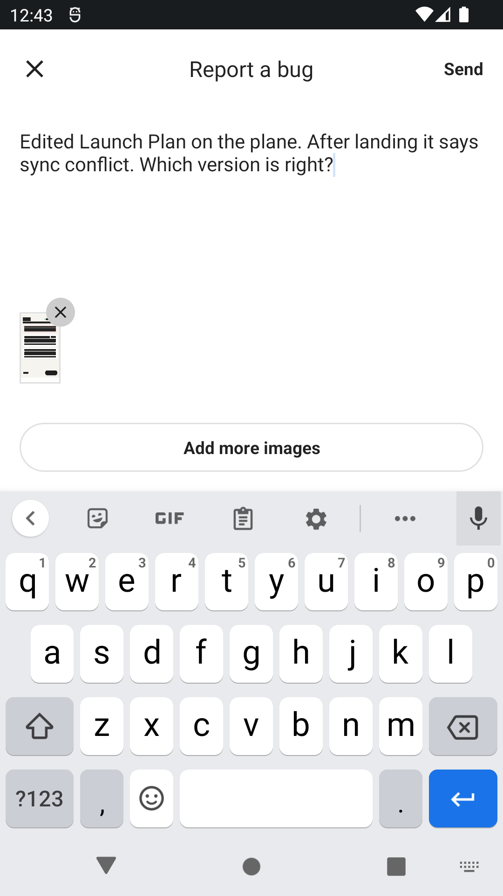</p>

*Measure's report screen. The attached screenshot hides the note text.*

## Four tests on an Android emulator

I ran these on an Android 12 (API 31) emulator, against a real Turso Cloud database and a real Measure project. It was a debug build, so treat the local timings as upper bounds.

### 1. Saving on a flight

Airplane mode on, edit "Product Launch Plan", tap Save. Then force-kill the app and open it again, still offline.

| Saved offline | Killed and reopened offline |
|---|---|
| 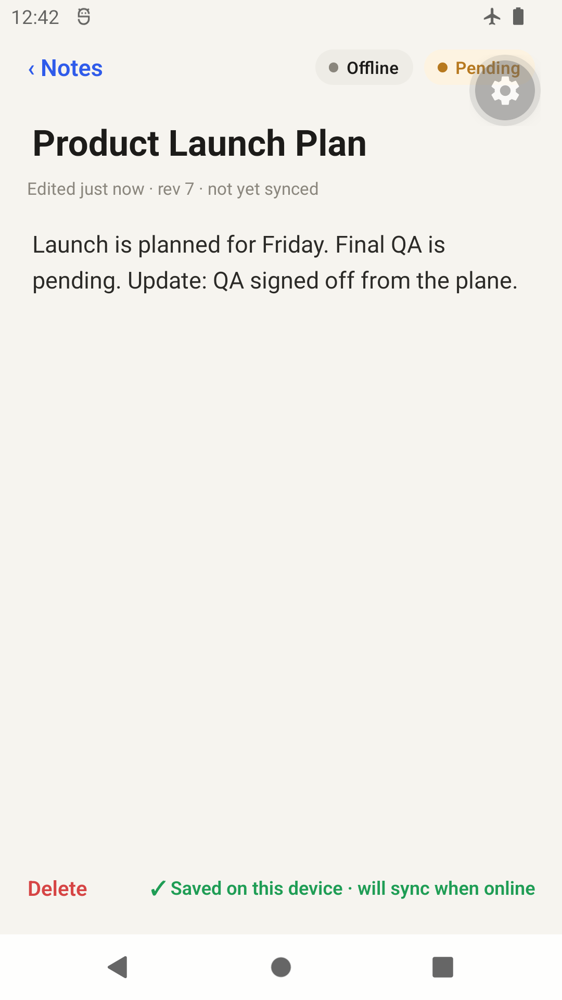 | 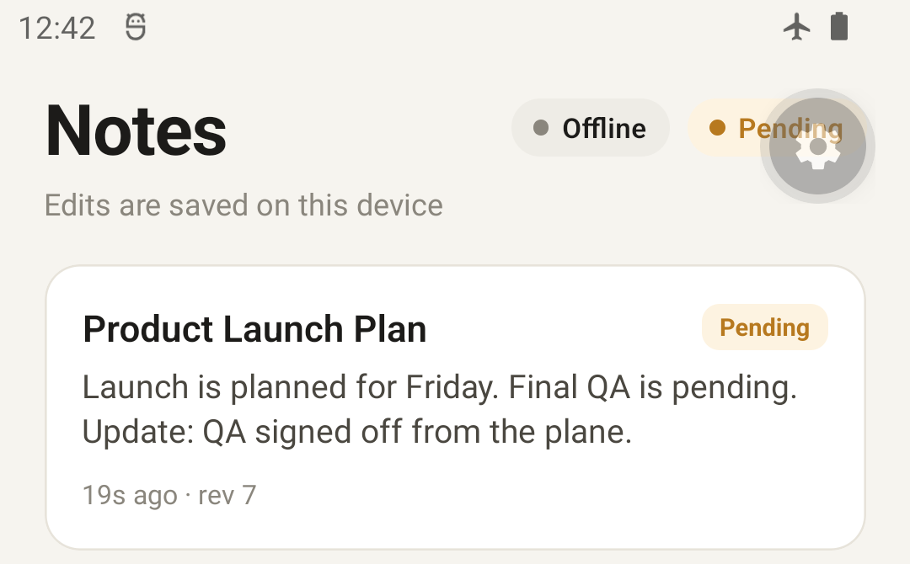 |

The edit was still there after the restart. Measure's session shows `note_saved_locally` with `is_online: false` and `local_write_ms: 45.5`, then `app_opened` with one pending change.

### 2. The same note on a laptop

With the phone online, a second client (a Node script playing the laptop) edited the same note in Turso Cloud. The server saved it at `00:40:40.7`, and the phone showed it at `00:40:45.1`.

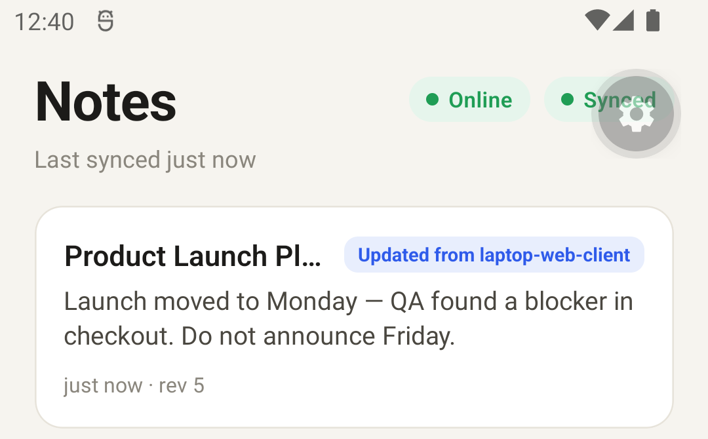

*The next live pull brought it over: 345 ms, 4,165 bytes.*

### 3. A slow connection

I throttled the emulator to GSM speed with GPRS latency (`adb emu network speed gsm`, `adb emu network delay gprs`) and turned Wi-Fi off so the throttling applied.

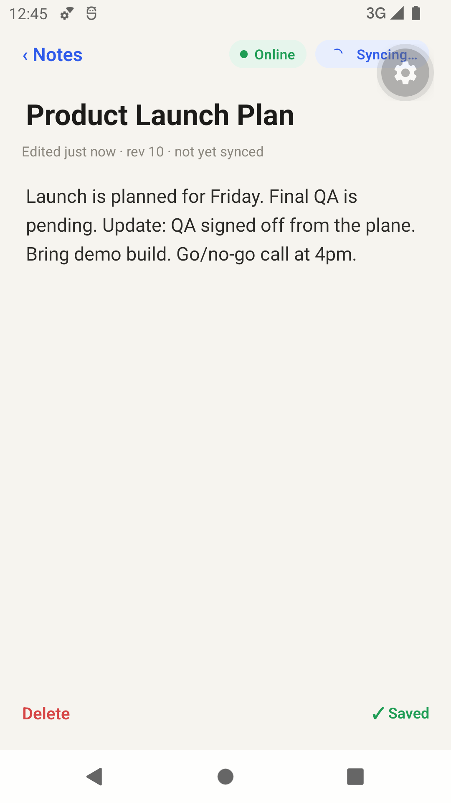

*"Saved" in 41 ms, while the sync pill still says "Syncing…".*

Saving stayed instant. Sync didn't, and Measure recorded all of it:

- `SlowSyncError: Turso push still running after 8000 ms`, grouped by phase
- then a real `java.io.IOException: unexpected end of stream` on `/v2/pipeline`, logged as `sync_failed` with `phase: push` after 31.5 s
- once the edit finally synced, a `sync_completed` that took 66.9 s

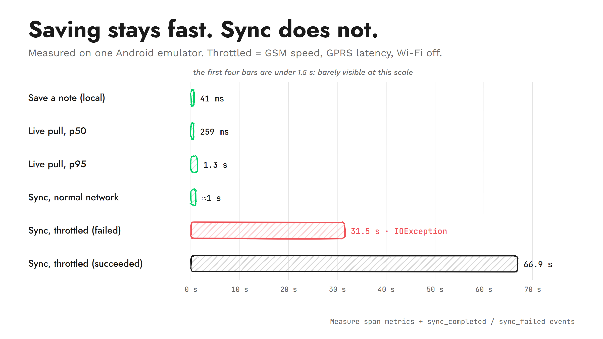

*Same app, same edit. Only the network changed.*

None of this crashed the app, so a crash reporter would have shown nothing. Without these traces and errors, all I'd have is a ticket saying "sync is slow".

### 4. Two people, one note

1. Offline on the phone, I edited the note. My edit started from **rev 6**.
2. On the "laptop", someone else edited the same note, and the server moved to **rev 7**.
3. The phone came back online and started syncing on its own.

| Conflict on reconnect | Pick a version |
|---|---|
| 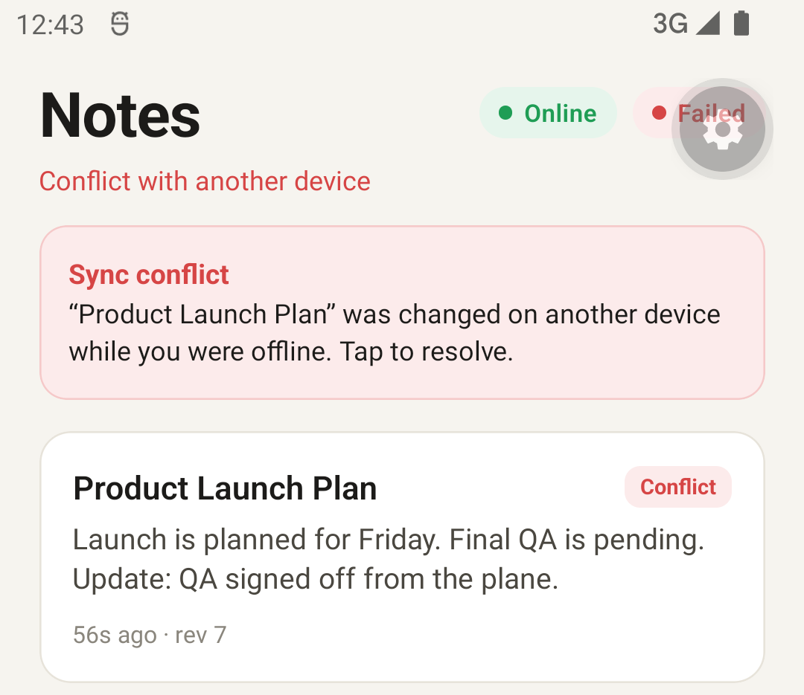 | 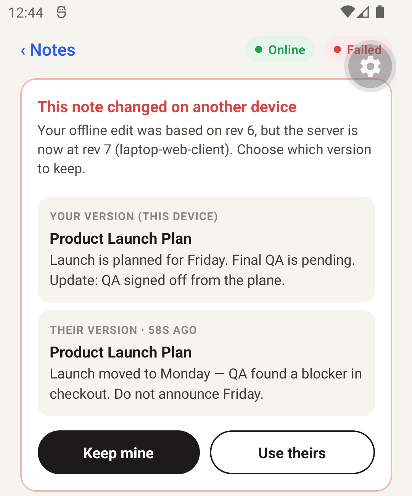 |

The revision check stopped the push **1.3 seconds** after reconnecting. Without it, the laptop's "Launch moved to Monday" would have been overwritten and nobody would have known.

Then I filed a bug report from inside the app, as a confused user would: *"Edited Launch Plan on the plane. After landing it says sync conflict. Which version is right?"* I tapped Keep mine, and the server ended at rev 8 with the phone's text.

## Ask Claude Code what went wrong

With a few sessions in Measure, I connected Claude Code to the [Measure MCP server](https://measure.sh/docs/mcp), which lets coding agents query an app's sessions, errors, traces and bug reports:

```bash
claude mcp add --transport http measure https://agent.measure.sh/mcp
```

Then I asked it, from inside the repo:

```text
A user filed a bug report about a sync conflict. Find it, analyze the session
timeline, connectivity changes, sync attempts and conflict events, identify
the root cause and suggest a fix.
```

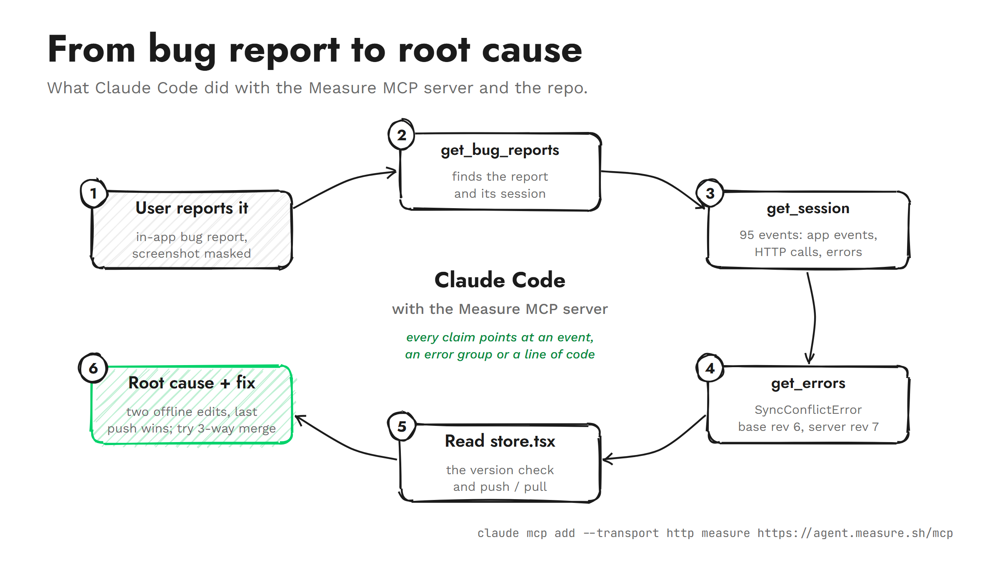

*Three MCP calls and one file read.*

It found the bug report, opened its session, and pulled out the timeline:

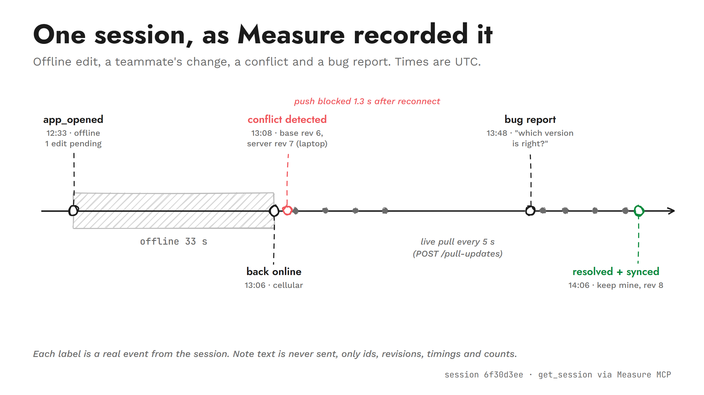

*Every label here is a real event from session 6f30d3ee.*

Its answer, shortened:

- **What happened.** The phone was offline for 33 seconds with one unpushed change (Turso's stats said 1). That edit started from rev 6. Meanwhile `laptop-web-client` saved rev 7, after the phone's edit. When the phone reconnected, the revision check saw rev 7 and blocked the push.
- **Why.** Two people edited the same note while one of them was offline. Turso settles that with last push wins, and the app can only ask the user to pick a version. It can't merge them.
- **What to change.**
  - Merge the two texts, using the rev 6 text as the common base (a three-way merge).
  - Track revisions per paragraph instead of per note.
  - Warn the user before they edit if the live pull shows the note changed elsewhere.

I could check every line of that against an event attribute, an error group or a line in `store.tsx`. That only works because the app logs revisions, device ids and Turso's stats, not just "sync failed".

It also pointed out an unhandled `ReferenceError: Property 'rerunRef' doesn't exist`. That one was mine: Fast Refresh had loaded half of an edit I was making. Measure had caught it without any setup.

Last, I had Claude create a [funnel](https://measure.sh/docs/funnels) through the MCP: `note_saved_locally → connectivity_changed → sync_started → sync_failed → conflict_resolved → sync_completed`. The median gaps between steps were 51 s, 0.9 s, 1.3 s and 58 s. With real users, that last gap would tell you how long people stay stuck on a conflict.

## Results

| What | Result | Source |
|---|---|---|
| Save a note locally (debug build) | 41–46 ms | `note_saved_locally.local_write_ms` |
| Laptop edit visible on the phone | about 4.4 s | wall clock, `remote_changes_received` |
| Live pull | p50 259 ms, p95 1.3 s | Measure span metrics |
| Sync on a normal network | about 0.9–1.2 s | `sync_completed` |
| Sync on throttled GSM | failed at 31.5 s, succeeded at 66.9 s | `sync_failed`, `sync_completed` |
| Conflict caught after reconnect | 1.3 s | `sync_failed.duration_ms` |
| Note text or auth token in Measure | none found | raw session data via MCP |

## What tripped me up

- **The Turso React Native package (0.8.3) tries to compile Rust on Android.** Its `build.gradle` runs `make android` even though prebuilt `.so` files ship in the package. A short Expo config plugin that turns that task off fixed the build (`plugins/withTursoPrebuiltLibs.js`).
- **Windows path length.** `react-native-safe-area-context`'s generated build paths went past 260 characters. Keep the project folder short.
- **`pull()` can return `true` right after your own push.** Compare rows before and after if you want to know whether another device changed something.
- **`stats().lastPullUnixTime` was in seconds in my tests.** The docs don't say.
- **`adb emu network speed` only slows the emulated cellular link.** Turn Wi-Fi off in the emulator first.
- **NetInfo's `isInternetReachable` reports `false` for a moment on cold start.** I went with `isConnected`.
- **Measure uploads in batches.** Put the app in the background before you query the MCP, or the newest events may not be there yet.

## FAQ

### Does Turso Sync work offline in React Native and Expo?
Yes. The first launch needs a connection to download the database. After that, reads and writes go to a local file, and changes wait there until you call `push()`. You need an Expo development build, not Expo Go.

### How does Turso Sync handle conflicts?
On push, the last push wins. On pull, unpushed local changes are rolled back, remote changes are applied, and the local changes are replayed on top in one atomic step ([docs](https://docs.turso.tech/sync/conflict-resolution)). If you need to catch concurrent edits, add a version column and check it before pushing.

### Can I use Measure with Expo?
Yes. `@measuresh/react-native` includes an Expo config plugin that sets your API keys, starts the native SDKs and turns on HTTP capture on Android ([getting started](https://measure.sh/docs/getting-started/react-native)).

### What is the Measure MCP server?
It's a remote MCP server at `https://agent.measure.sh/mcp`. Coding agents like Claude Code, Cursor and Codex use it to query your app's errors, sessions, traces, bug reports and funnels ([docs](https://measure.sh/docs/mcp)). It's one of the more practical pieces of AI-native mobile development I've used, because the agent reads what happened on real devices instead of guessing.

### Does Measure capture API tokens from network requests?
No. `Authorization`, `Cookie`, `Set-Cookie`, `X-Api-Key` and similar headers are never collected, and request and response bodies are off by default ([docs](https://measure.sh/docs/adaptive-capture#blocked-headers)).

### Is Measure open source?
Yes. The code is at [github.com/measure-sh/measure](https://github.com/measure-sh/measure), and you can [host it yourself](https://measure.sh/docs/hosting).

## Try it

```bash
git clone <this repo> && cd turso_measure_demo
cp .env.example .env          # Turso URL + token, Measure API key + URL
npm install
npm run remote:setup          # creates the notes table in Turso Cloud
npx expo prebuild --platform android --clean
npx expo run:android
```

`DEMO.md` walks through the four tests step by step.

## Would I build it this way again?

Yes, for any app people use away from good Wi-Fi.

- **Turso** let me write the app as if the network were always there. Saving never waits, and sync is two calls.
- **Measure** showed me what sync does on a bad connection, which I'd never have seen from my desk, and kept the user's bug report next to the session that explained it.
- **Claude Code** went from that bug report to a cause I could check, in a handful of tool calls.

The next thing I want to try is the three-way merge, so most conflicts never reach the user.

---

**Links:** [Turso](https://turso.tech) · [Turso Sync docs](https://docs.turso.tech/sync) · [Turso conflict resolution](https://docs.turso.tech/sync/conflict-resolution) · [Measure](https://measure.sh) · [Measure React Native SDK](https://measure.sh/docs/getting-started/react-native) · [Measure performance tracing](https://measure.sh/docs/performance-tracing) · [Measure bug reports](https://measure.sh/docs/bug-reports) · [Measure MCP](https://measure.sh/docs/mcp) · [Measure on GitHub](https://github.com/measure-sh/measure) · [Expo development builds](https://docs.expo.dev/develop/development-builds/introduction/) · [Claude Code](https://claude.com/claude-code)
